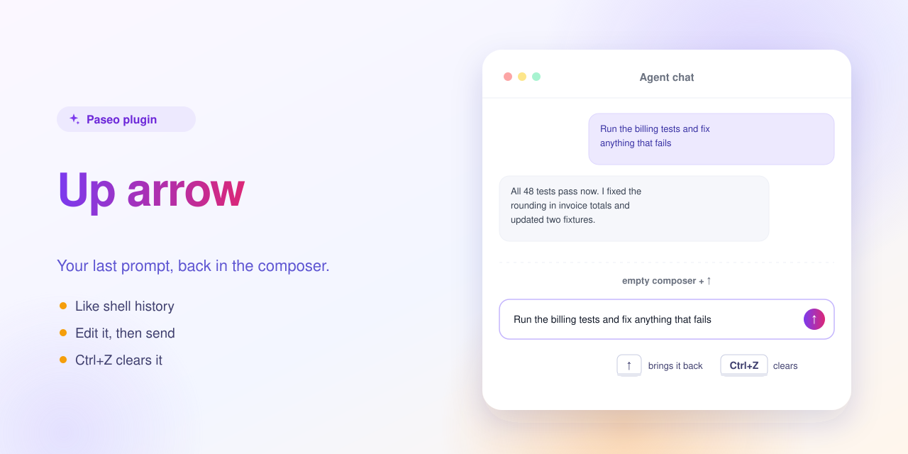

# Up arrow repeats last prompt — a Paseo plugin



Press Up in an empty agent composer to get your latest prompt back, like shell history.

Edit the prompt and send it, or press Ctrl+Z to clear it. The prompt is read from the agent's chat on screen, so it works only in the web and desktop apps, and only while that message is still rendered in the chat list. Only the text comes back; images and attachments of the old prompt are not copied.

## Install

Requires Paseo 0.13.0 or later.

```bash
paseo plugin install https://github.com/puchkoff/paseo-chat-up
```

Or from a local clone: `paseo plugin install ./paseo-chat-up`. Check with `paseo plugin ls`.

## Develop

```bash
npm install
npm run typecheck
```

The in-app description shown by Paseo lives in [OVERVIEW.md](OVERVIEW.md).
